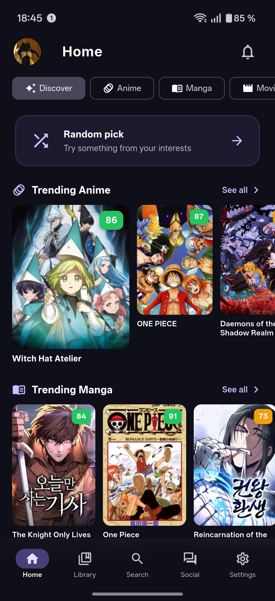
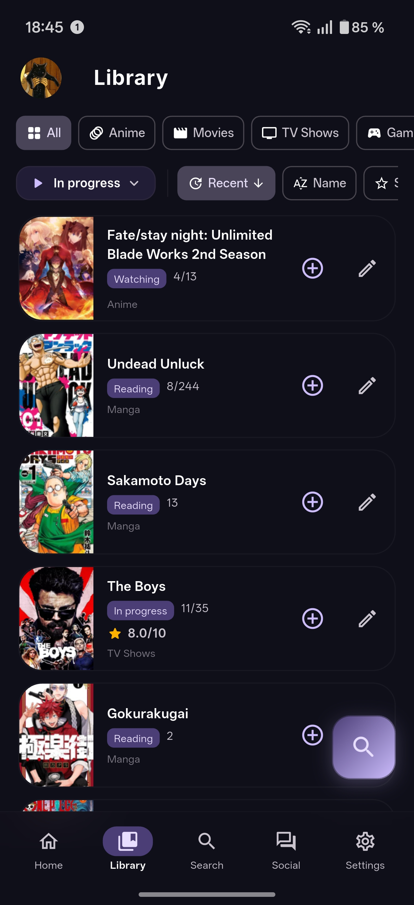
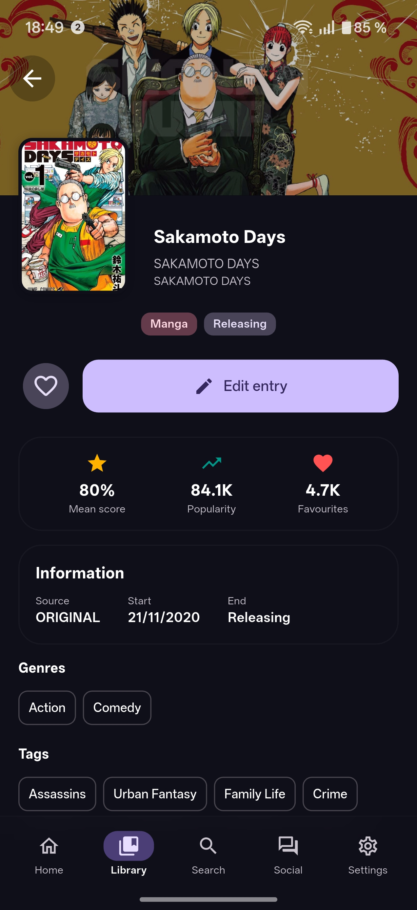
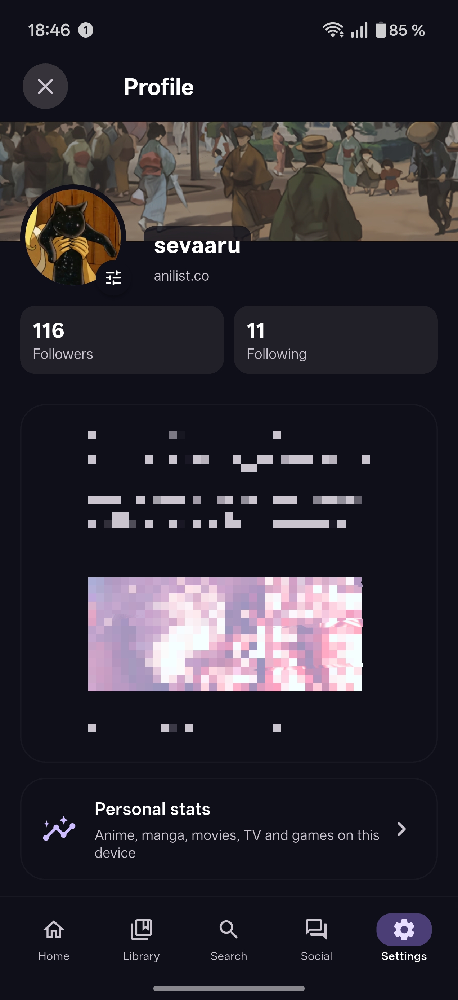
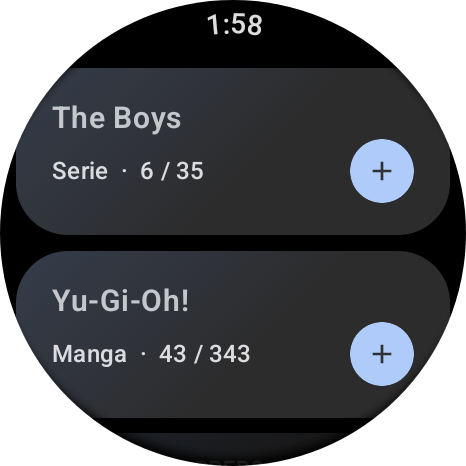
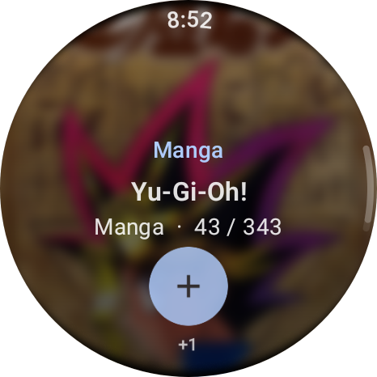

# Cronicle

One library for the stuff you watch, read and play. Anime, manga, movies, shows, games, books. It keeps your list on the device, so it still works when the network doesn't.

**v2.1.11** · build 71

Android phone and tablet · Wear OS companion · home screen widget
Android 8.0+ · Wear OS 3+
English and Spanish. Dark by default. Light mode is in Settings if you insist.

---

## Screenshots

The library and the trophy room have been redesigned since some of these were taken. They're still useful if you want a look at the app before installing.

### Phone

| Home | Library |
|---|---|
|  |  |

| Detail | Profile |
|---|---|
|  |  |

### Watch

| Library | Detail |
|---|---|
|  |  |

---

## What you actually get

Your library lives in a local SQLite database (Drift). Progress, scores, status, dates and notes are yours. Sync is optional and only runs for the accounts you connect.

Each entry is a card: cover, status, a progress gauge, and buttons to bump progress or edit. Scores use a segmented bar instead of a sad old slider. Anime and manga can show the next air date, how far behind you are, and how many times you've rewatched or reread something. That repeat count syncs back to AniList.

There's also a trophy room. Do the thing, get the trophy, get a little unlock notice. Not life-changing. Kind of fun.

## Accounts

Hook up what you use. Leave the rest alone.

- **AniList.** Login, library sync, activity, inbox, forums, characters and staff, plus their advanced scoring if you're into that.
- **Trakt.** Movies and shows: history, watchlist, ratings, episode progress, stats.
- **Steam.** Import the games you own, open a game, poke at achievements. Steam activity shows up next to AniList in the social feed.
- **IGDB** (through Twitch) for the game catalog, and **OpenCritic** when a game actually has critic reviews.
- **Google Books** for search, subjects, editions and reading progress.

Discover is a feed of whatever categories you leave on, with a "surprise me" button for when you don't want to pick. Search hits the same sources from one bar. Favourites, character and staff pages, and a stats screen are all in the profile.

## Phone, watch, widget

- Material 3. You can reorder the bottom nav, the library types and the feed chips.
- Android shortcuts for the screens you open all the time.
- Home screen widget: your library, covers cached on disk, light or dark per widget, and a button to log progress without opening the app. It follows the app language.
- Notifications for new episodes and chapters, plus an optional AniList inbox check that doesn't wipe your unread count.
- Backup to a local JSON file. Google Drive backup is there too if that build has Google sign-in wired up.
- Wear OS app, if you want the list on your wrist. It pairs with the phone over the Wearable Data Layer and stays in sync. The watch build is still **v1.1.2**. It has to be signed with the same key as the phone app or they won't talk to each other.

## Install

1. Grab the latest APK from the [releases page](https://github.com/Sevaaru/Cronicle/releases/latest). Current phone build is `v2.1.11`.
2. Android will complain about installing from this source. That's normal. Allow it.
3. Watch, if you care: install `Cronicle-wear-v1.1.2.apk` from the same kind of release, signed with the same key.

## Not affiliated, not a pirate site

Cronicle isn't AniList, Trakt, Steam, IGDB, Twitch, OpenCritic or Google. It doesn't host video, books or games. It shows metadata those APIs return after you log in with your own account.

## License

<pre>
Copyright © 2026 Sevaaru
Copyright © 2024 Cronicle Open Source Project
</pre>
